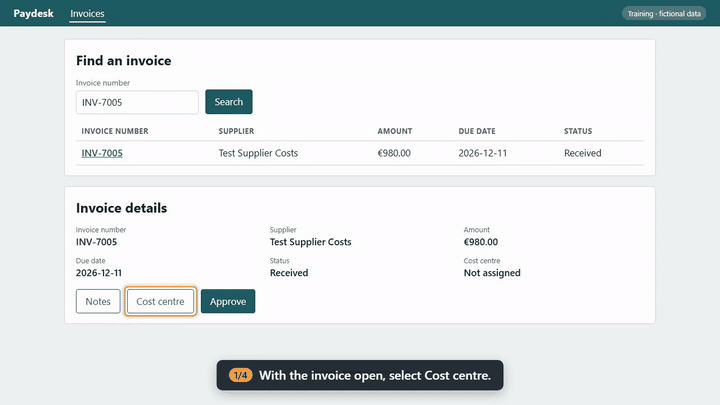

# FigJam Process Pipeline

**Turns process diagrams drawn by business teams in FigJam into validated, versioned, machine-readable workflows that developers, testers and AI agents can build against.**

**[See the live demo site](https://shawndale-glitch.github.io/figjam-process-pipeline/)**: guides with narrated videos, and [how a guide catches a software change](https://shawndale-glitch.github.io/figjam-process-pipeline/drift/). Or run it yourself in the browser, with nothing to install:

[](https://codespaces.new/shawndale-glitch/figjam-process-pipeline?quickstart=1)

This project explores one question:

> How do you get a whiteboard drawing, made collaboratively by people who aren't modellers, to become a contract that software can be checked against?

Instead of treating a process diagram as a picture, the pipeline treats it as **source data**: every shape comes from a shared component library, every line has a meaning, and the board is read as facts, checked against written rules, versioned by what actually changed, and published as YAML, a documentation page and test scenarios. A board that breaks the rules is never "fixed up" silently. Its author gets one line per problem and a link to the exact shape.

| If you have… | Read |
|---|---|
| 30 seconds | This page, down to [Why this matters](#why-this-matters), or the [demo site](https://shawndale-glitch.github.io/figjam-process-pipeline/) |
| 5 minutes | The [rule catalogue](governance/workflow-rules.yaml), one [example board](examples/patterns/README.md) and one [procedure](procedures/procure-to-pay/P2P-03-P03/procedure.yaml) with its [guide](docs/procedures/procure-to-pay/P2P-03-P03.md) |
| 20 minutes | The [tooling](tooling/README.md), the [self-test](tooling/selftest.py) and the [schema](schemas/workflow.schema.json) |
| An interview slot | The [walkthrough](WALKTHROUGH.md): a 20-minute live demo of this repository |

## What this demonstrates

- Treating diagrams as structured, machine-readable source content
- A rule catalogue as configuration (`workflow-rules.yaml`), read by code, CI and reviewers alike
- Validation gates that explain themselves: rule ID, the shape's label and a deep link to it
- Semantic versioning computed from a diff of the process, not chosen by hand
- Docs-as-code outputs from one source: data (`workflow.yaml`), a page (Mermaid) and tests (Gherkin)
- Governance for collaborative authoring: drafts, review by a business owner, release tags
- Conformance checks that let application teams prove their build matches a released process version
- Validation of the planning spreadsheet the diagrams are scheduled from
- Source documents linked from the diagram: a Document shape carries its share URL into `workflow.yaml` and the page
- A self-test that proves every rule fires, run in CI on every push
- Procedures as code: each task on a process becomes a guide and a narrated video in Spanish and English, recorded by Playwright from one YAML file
- Guides that test themselves: the recording is a QA run, so a screen change fails CI at the step that no longer matches
- AI in the loop with a human gate: an assistant can extract a board, report and propose fixes, but a release needs a pull request approved by someone other than its author

## Architecture


```text
              FIGJAM BOARD  (shared component library, one section per process)
                      │
                      │  tooling/figjam_extract.js (plugin API)  or  tooling/figma_rest.py (REST, for CI)
                      ▼
                 board.json                   ← facts only: components, props, positions, connectors
                      │
                      │  tooling/workflow_intake.py
                      ▼
        VALIDATION GATE  R1–R9 · W1–W9 · schema   ← rules from governance/workflow-rules.yaml
           │                          │
      rejected                    accepted
           ▼                          ▼
   report to the author        semantic diff → version
   (nothing written)                  │
                     ┌────────────────┼────────────────┐
                     ▼                ▼                ▼
              workflow.yaml     process page     scenarios.feature
                     │
                     ▼
        pull request → business-owner approval → tag <ID>@<semver> → conformance in app repos
```

## Why this matters

Process workshops produce drawings. Delivery teams need contracts. The gap between the two is usually closed by someone re-typing the diagram into a spec, and the spec and the board drift apart from that day on.

Closing the gap needs a few things that a whiteboard doesn't give you by default:

- **one meaning per shape**, so a machine can tell an activity from a decision from a system
- **explicit flow semantics**: sequence, hand-off and association are different lines
- **every step owned by a role**, so the process says who does what
- **a version that means something**: a removed step is a breaking change, a rewording isn't
- **feedback the author can act on**, in the author's own words and on the author's own board
- **a review step a business owner signs**, before anything is called "validated"

This pipeline makes each of those a rule, enforces it with tooling, and keeps the people drawing the process in charge of the content.

## Example

Real first-session boards fail in predictable ways: the legend gets pasted into the process area, a decision exit has no condition, a system is joined with a solid line, another is left floating. The self-test reproduces exactly that on the fictional invoice-approval example, and the gate reports:

```text
## Findings: 5 errors, 2 warnings

- ❌ R2 «» Off-library section: insert the shape from Assets instead (open in FigJam)
- ❌ R3 «» A link to a system, document, data store or rule must be a dashed (association) connector (open in FigJam)
- ❌ R5 «Goods delivered, Order received» Expected exactly one start event, found 2
- ❌ R4 «PO matches?» Every exit from a decision needs a condition label on the connector (open in FigJam)
- ❌ R5 «Order received» Dead end: no outgoing flow (open in FigJam)
- ⚠️ W5 «ERP» System is not linked to any step (open in FigJam)
- ⚠️ W5 «Spreadsheet» System is not linked to any step (open in FigJam)
```

Every line names the rule, quotes the label the author typed, and links to the shape. Fixed, the same board passes with 0 findings and is published as data. For the pattern teams use to say *which system, which document, when, and with what data* for each step, see [`examples/patterns/`](examples/patterns/README.md).

## From process to procedure

A process says *who does what*. A procedure says *how, on screen*: one `procedure.yaml` per task in a system, tied to a lane and a step on the process board. From that one file the pipeline produces the guide page, a narrated video in each language with subtitles, step screenshots and a QA report, and they can't disagree because they come from the same run.



```yaml
# procedures/procure-to-pay/P2P-03-P03/procedure.yaml (excerpt)
procedure:
  id: P2P-03-P03
  title: { es: Asignar el centro de coste, en: Assign the cost centre }
  process: P2P-03                  # the board it belongs to...
  step_ref: Register invoice       # ...the step it carries out...
  role: AP Clerk                   # ...and the lane that does it (rules P6, P8)
  starts_from: P2P-03-P01          # open an invoice: a shared procedure, run first and cut from the video
fixtures:
  invoice: { supplier: Test Supplier Costs, amount: 980, due: +30d }   # created through the API, deleted after
steps:
  - id: S3
    say: { es: Pulse Buscar en la ventana. Aparece el centro de coste., en: Select Search in the window. The cost centre appears. }
    do: { action: click, target: { role: button, name: { es: Buscar, en: Search }, within: { role: dialog, name: { es: Centro de coste, en: Cost centre } } } }
    expect: { target: { role: row, name: { es: CC-300, en: CC-300 }, within: { role: dialog, name: { es: Centro de coste, en: Cost centre } } } }
verify:
  - { fixture: invoice, field: cost_centre, equals: CC-300 }   # the API confirms the data changed
```

How a run works, per language:

1. **Fixtures** (fictional records) are created through the system's API, so every run starts from known data.
2. Each step's `say` text becomes **speech**, and the narration sets the pace.
3. **Playwright** opens the screens in that language, captions the step, highlights the control, acts, and checks the expected result. Controls are found the way a user sees them (role and name, label, text), never by CSS or test ids (rule P5).
4. The **API confirms** the data really changed (`verify`), and the fixtures are deleted.
5. **ffmpeg** joins recording and narration into a 1080p MP4 with a subtitle track. A video is kept only if every step and every check passed.

**Guides that test themselves.** CI runs every procedure against the demo app on each push. A second job starts the app with `--drift`, which renames the Approve button as a vendor release might, and asserts that the approval guide fails at exactly that step:

```text
FAIL  P2P-03-P04 EN  1/2 steps  FAILED at S1: could not find button name "Approve" on screen within 8 s
```

The demo app, **Paydesk**, is a small fictional accounts-payable app in Spanish and English ([`examples/procedure-demo/`](examples/procedure-demo/)). A real system plugs in with a five-method adapter (`create`, `get`, `delete`, `url`, `version`) in `tooling/procedure_run.py`; its credentials and sign-in session stay outside the repository. The guides are in [`docs/procedures/`](docs/procedures/index.md).

## Try it

The examples are small, fictional and valid. The self-test runs them, then breaks copies on purpose to prove each rule fires.

```bash
python -m venv .venv
# Windows: .venv\Scripts\activate    macOS/Linux: source .venv/bin/activate
pip install -r requirements.txt
python tooling/selftest.py
python tooling/workflow_intake.py examples/patterns/QA-003-activity-pattern.board.json --dry-run
```

To see the procedures as a two-act demo, every guide passing and then one failing after a simulated vendor release, open a [Codespace](https://codespaces.new/shawndale-glitch/figjam-process-pipeline?quickstart=1) (everything is preinstalled) and run `python tooling/demo.py`. On your own machine, install the media extras first. Add `--headed` to watch the browser, and `--serve` to click through Paydesk by hand afterwards.

To record the procedures (needs the media extras; the narration uses Windows voices or Piper, or `--voice none`):

```bash
pip install -r requirements-media.txt
python -m playwright install chromium
python tooling/demo.py
python tooling/procedure_check.py
python tooling/procedure_run.py procedures/procure-to-pay/P2P-03-P04/procedure.yaml --start-demo
python tooling/procedure_render.py --all
```

To read a real board, run `tooling/figjam_extract.js` through the Figma plugin API (for example the Figma MCP `use_figma` tool) with `FILE_KEY`, `PAGE_ID` and `SECTION_ID` filled in, and save the result as `board.json`. In CI, `workflow_intake.py --url "<FigJam section link>"` reads it through the REST API with a `FIGMA_TOKEN`. To check a planning workbook: `python tooling/inventory_check.py path/to/inventory.xlsx`.

CI runs the self-test, a strict docs build, every procedure against the demo app, and the drift check on every push. See [`.github/workflows/ci.yml`](.github/workflows/ci.yml).

## The rules at a glance

| Errors (block) | Warnings (block only at review) |
|---|---|
| **R1** one header; process ID format and known area | **W1** activity labels are verb + object |
| **R2** library shapes only; every step labelled | **W2** lanes don't overlap |
| **R3** connectors attached at both ends; associations dashed | **W3** no loose text in the process |
| **R4** decisions have ≥ 2 exits with unique conditions | **W4** sticky notes are reviewed before approval |
| **R5** one start; everything reachable; no dead ends | **W5** systems, documents and notes are linked to a step |
| **R6** every step sits in exactly one role lane | **W6** markers match as-is / to-be |
| **R7** header date, status and version use allowed values | **W7** a decision label is a question |
| **R8** no "removed step" marker at review | **W8** at most 15 activities per diagram |
| **R9** no library placeholder text left behind | **W9** document links are https:// share URLs |

Procedures have their own (P1–P9, PW1–PW2): test or training environments only, every text in each language, an expected result for every step, user-visible locators only, role and step on the linked process in `workflows/`, no personal data typed in, fixtures named Test/Prueba/Demo, a valid `starts_from`, at most 12 steps. The planning workbook has its own catalogue (I1–I8). Full wording, rationale and the versioning, rejection and conformance policies are in [`governance/workflow-rules.yaml`](governance/workflow-rules.yaml).

## Repository map

```text
.
├── README.md                 # you are here
├── WALKTHROUGH.md            # what I demonstrate live in an interview
├── governance/               # workflow-rules.yaml (the rules), areas.yaml (allowed ID prefixes)
├── schemas/                  # workflow.schema.json and procedure.schema.json: the contracts
├── tooling/                  # extractor, intake, render, release, conformance, inventory check, procedures, self-test
├── examples/                 # library-selftest/, patterns/, and procedure-demo/ (Paydesk, the fictional app)
├── procedures/               # one procedure.yaml per task, by area
├── diagrams/                 # pipeline diagram (SVG), procedure recording (GIF)
├── conformance/              # bindings template for application teams
├── workflows/                # published workflows (P2P-03, in review) and consumers.yaml
├── docs/                     # generated process pages and procedure guides with videos (MkDocs)
└── .github/workflows/        # CI self-test, and the intake, release and conformance workflows
```

## Technology and tooling

- FigJam with a published component library (Spanish and English), native connectors
- Figma Plugin API and REST API for extraction
- Python for linting, versioning, rendering, release and conformance
- YAML for rules and workflows, JSON Schema for the workflow contract
- Mermaid for diffable flowcharts, Gherkin for executable scenarios
- Playwright for recording procedures, local text-to-speech (Windows SAPI or Piper) and ffmpeg for narrated videos with subtitles
- MkDocs Material with strict builds
- GitHub Actions for CI, intake pull requests, release tagging and reusable conformance checks
- Claude with the Figma MCP server for extraction, review and AI-assisted board fixes, with a person approving every release

## Project status

This is a working proof of concept, used on real process-redesign sessions.

- The plugin-API extractor, intake, inventory check and self-test have been run against real boards.
- `figma_rest.py` (the REST reader used by CI intake) hasn't yet been run against the live Figma API.
- The procedure engine has recorded and verified guides against a real enterprise application's test environment through its own adapter; here it records the fictional Paydesk app instead.

The **production implementation** runs in a private repository because the processes are a client's. Everything here is a sanitized, clean-room presentation: the examples are a **fictional invoice-approval process**, a **generic front-desk check-in** and **Paydesk**, a fictional accounts-payable app, component keys and file keys are placeholders, and no client material is included.

## About

Designed and implemented by **Shawn Dale**, principal-level technical documentation professional specializing in documentation architecture, developer experience, APIs, AI-assisted documentation, and structured knowledge systems.

> Diagrams are documentation too. This makes them documentation a machine can hold you to.

Related: [AI-Native Documentation Architecture](https://github.com/shawndale-glitch/ai-documentation-architecture), the content model this pipeline's outputs are designed to sit in.

## License

Copyright © 2026 Shawn Dale. All rights reserved. The code is published for reading and reference; no license is granted to copy, modify or redistribute it. See [LICENSE](LICENSE).
