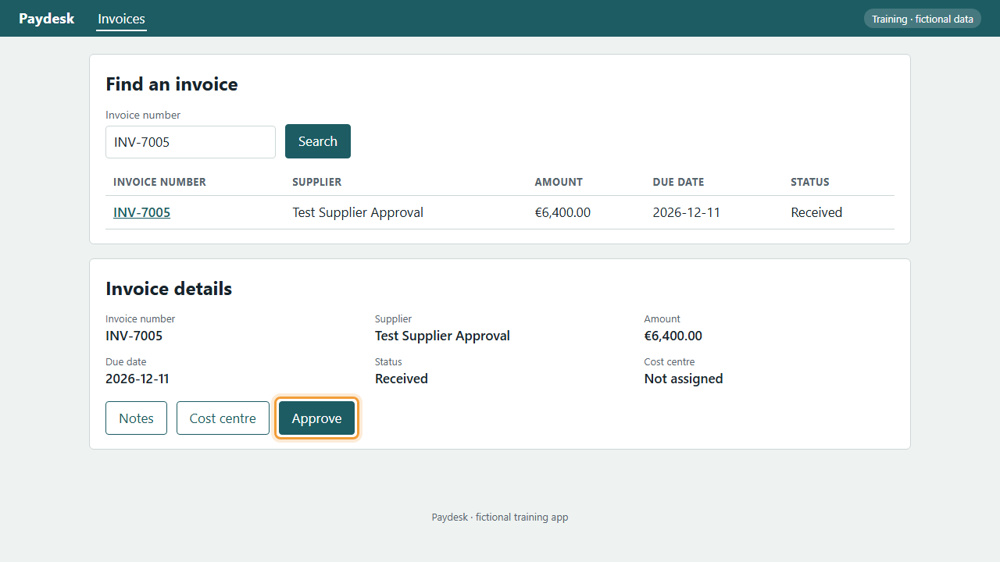
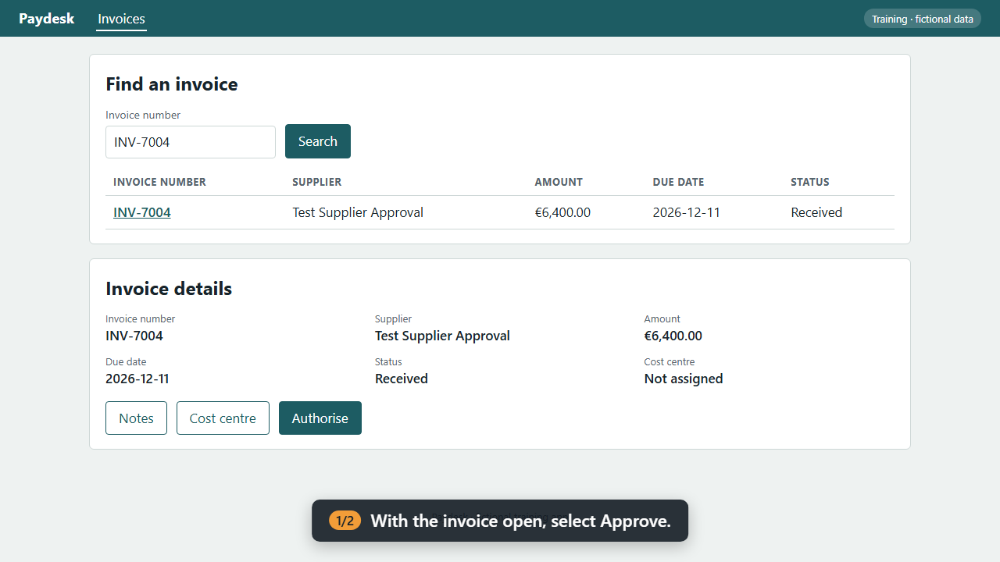

# How a guide catches a change

Software changes under its documentation all the time. A vendor release renames a button, moves a field or adds a confirmation window, and the guide still says the old thing. Usually nobody notices until someone new follows it and gets stuck.

Here, every guide is also a test. This page shows one catching a change.

## The change

The demo app, Paydesk, has a `--drift` switch that simulates a vendor release: the **Approve** button becomes **Authorise**. Nothing else changes.

=== "Before the release"

    

    Step 1 of [Approve an invoice](procedures/procure-to-pay/P2P-03-P04.md) finds **Approve**, highlights it and clicks it. The guide's screenshot comes from this run.

=== "After the release"

    

    The same step runs again. The caption still says *select Approve*, but there is no Approve on screen. The run stops here and keeps this screenshot as evidence.

## What the run reports

```text
FAIL  P2P-03-P04 EN  1/2 steps  FAILED at S1: could not find button name "Approve" on screen within 8 s
```

| Step | Status | Narration | Error |
|---|---|---|---|
| S1 | fail | With the invoice open, select Approve. | could not find button name "Approve" on screen within 8 s |

No video is kept from a failed run, so a wrong video is never published. The next time the guides are rendered, the guide carries this warning instead of its green "Verified" stamp:

!!! failure ""
    The last run failed at step S1: could not find button name "Approve" on screen within 8 s. The guide may not match the system.

## Where it runs

- **In CI, on every change.** The `drift` job in [the CI workflow](https://github.com/shawndale-glitch/figjam-process-pipeline/blob/main/.github/workflows/ci.yml) starts the drifted app and *expects* this failure. If the approval guide ever passed against the renamed button, the gate itself would be broken, and that job fails instead.
- **On your screen, in five minutes.** [](https://codespaces.new/shawndale-glitch/figjam-process-pipeline?quickstart=1) then `python tooling/demo.py`.
- **On a laptop, live.** `python tooling/demo.py --headed` shows the browser doing each step, then failing after the release.

## The fix is one line

Updating the guide means changing the button name in [`procedure.yaml`](https://github.com/shawndale-glitch/figjam-process-pipeline/blob/main/procedures/procure-to-pay/P2P-03-P04/procedure.yaml) and running it again. The screenshots, the narrated videos in both languages and the guide page are all regenerated from that run, so nothing is re-shot or re-written by hand.
