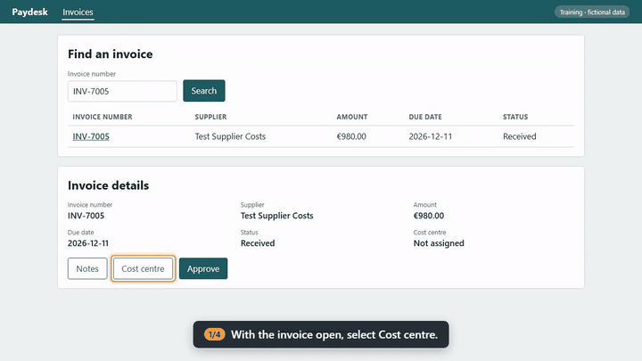

<!-- The site's landing page, written by hand. Every other page is generated; add each new one to nav in mkdocs.yml. -->

# Documentation that tests itself

A process is drawn on a whiteboard. From each task in it, one small file describes how to do it on screen. From that one file the pipeline produces:

- a step-by-step guide with screenshots
- a narrated video in Spanish and English, with subtitles
- a test run against the real screens

When the software changes and a guide stops matching it, the build fails before anyone follows a wrong instruction.

Everything here runs on **Paydesk**, a small fictional accounts-payable app made for this demo, with fictional data.

## Three ways in

-   **Watch it (2 minutes)**

    ---

    Play the approval guide's video below, then open any guide under [Procedures](procedures/index.md). The video, the screenshots and the steps all come from the same recorded run.

-   **See it catch a change (1 minute)**

    ---

    A vendor release renames one button. [How the guide fails](drift.md) shows the before and after screens and the failed step.

-   **Run it yourself (5 minutes)**

    ---

    

    This opens the code in your browser with everything installed. Run `python tooling/demo.py` and watch every guide pass, then watch one fail after the release.

<video controls preload="metadata" width="100%" src="procedures/procure-to-pay/media/P2P-03-P04-en.mp4"><track kind="subtitles" srclang="en" label="English" src="procedures/procure-to-pay/media/P2P-03-P04-en.vtt" default>Your browser can't play this video.</video>

*Approve an invoice: recorded, narrated and checked by the pipeline. Nobody edited the video.*

## The 3-minute tour

1. **The process.** The invoice-approval process starts as a whiteboard of lanes and steps. The pipeline checks it against [the house rules](https://github.com/shawndale-glitch/figjam-process-pipeline/blob/main/governance/workflow-rules.yaml) and publishes it as a page: [P2P-03: Invoice approval](processes/procure-to-pay/P2P-03.md).
2. **The procedure.** Each task in a lane gets one file that says what to do, what you should then see, and what the data should look like afterwards: [the approval procedure](https://github.com/shawndale-glitch/figjam-process-pipeline/blob/main/procedures/procure-to-pay/P2P-03-P04/procedure.yaml). It names its role and its process step, so it can't drift away from the process without a rule failing.
3. **The guide.** The pipeline opens the app, does each step, captions it and highlights the control, and checks the result. Then it asks the app's API whether the data really changed. The output is [the published guide](procedures/procure-to-pay/P2P-03-P04.md), with its date of last verification.
4. **The gate.** On every change, CI runs every guide against the app. A second job runs the app as it would be after a vendor release and expects the approval guide to fail at the renamed button. [That job's runs](https://github.com/shawndale-glitch/figjam-process-pipeline/actions/workflows/ci.yml) are public.
5. **Real systems.** A real application connects through a five-method adapter (create test data, read it back, delete it, build a screen address, report its version). Credentials and sign-in sessions stay outside the repository, and procedures run only against test or training environments.

## Why it matters

Written guides go stale silently. A screen changes, nobody updates the guide, and new staff find out the hard way. Here the guide is also the test: when it goes stale, it fails, and the failure says which step and why. Videos are re-recorded from the same file, so updating a guide is a one-line edit, not a re-shoot.

## About this site

Every other page is generated from the [repository](https://github.com/shawndale-glitch/figjam-process-pipeline) and never edited by hand:

- **Processes**: one page per validated workflow, written by `tooling/workflow_intake.py`.
- **Procedures**: one guide per task, with screenshots and a narrated video in Spanish and English, written by `tooling/procedure_render.py`. Each guide carries the result of its last QA run.
