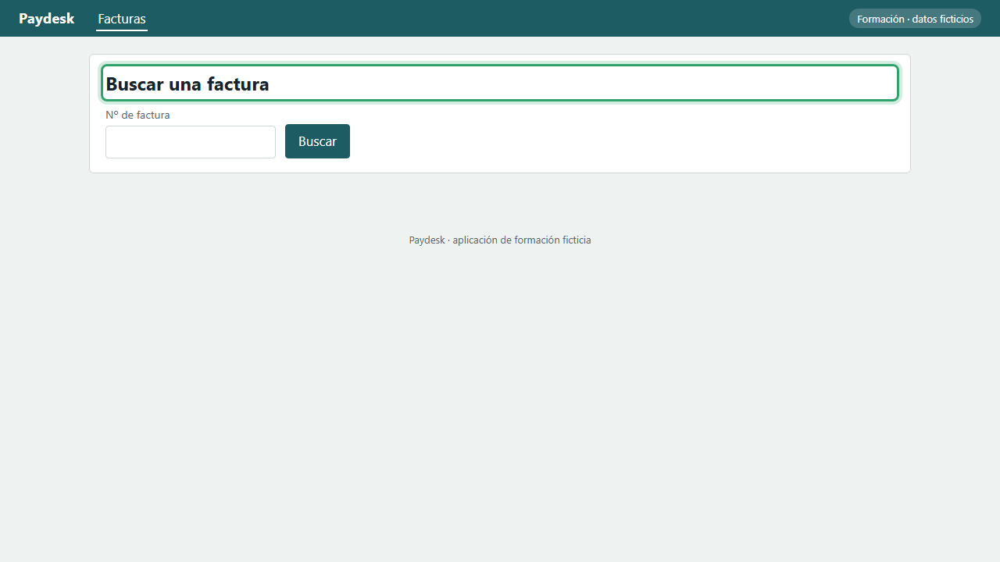
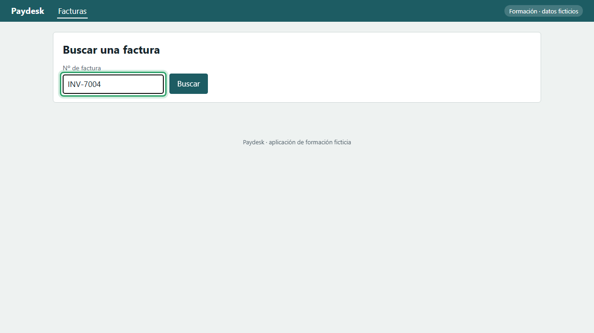
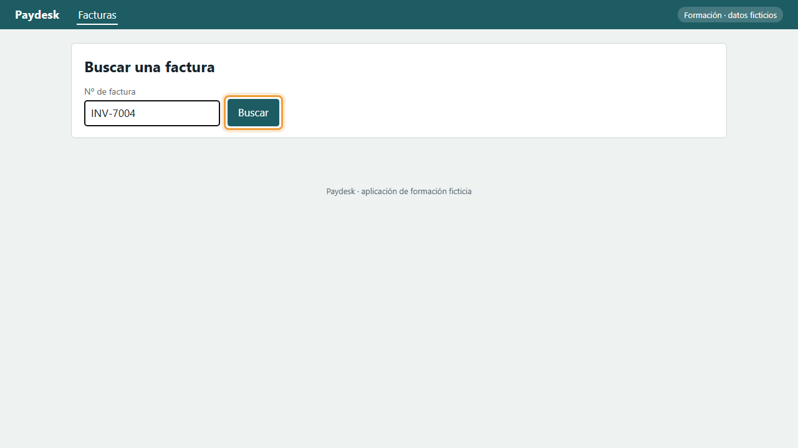
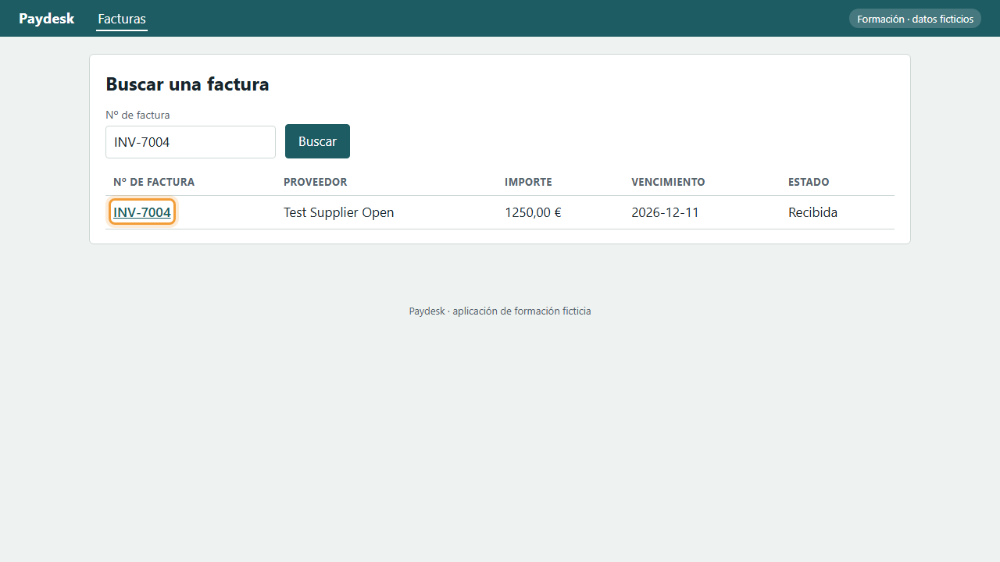
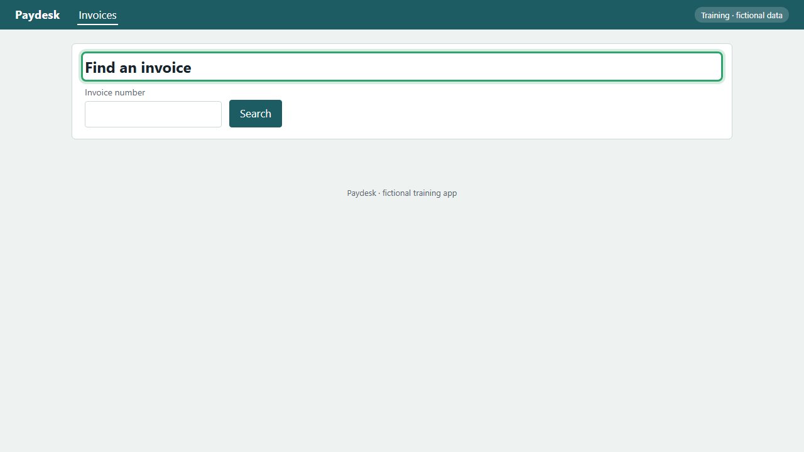
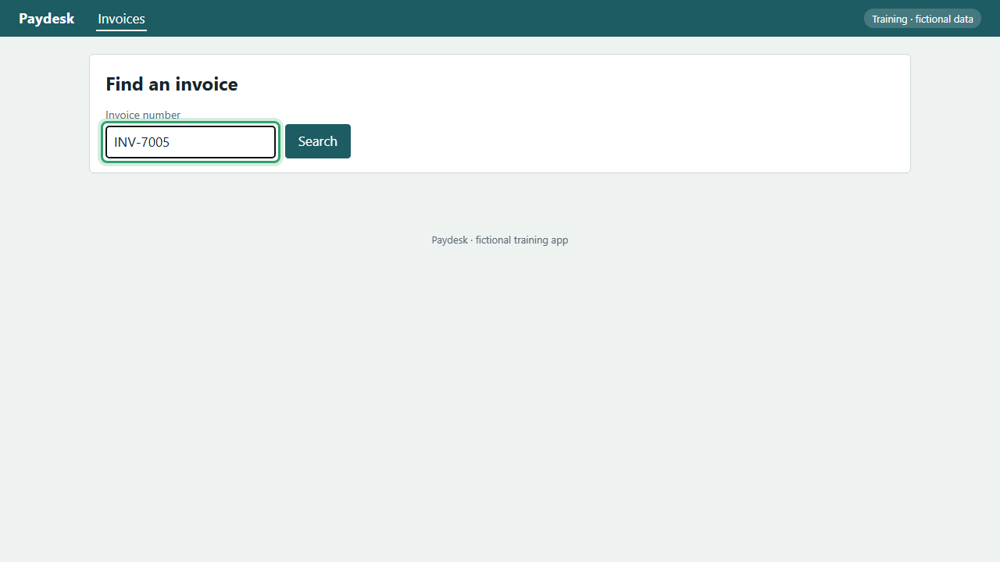
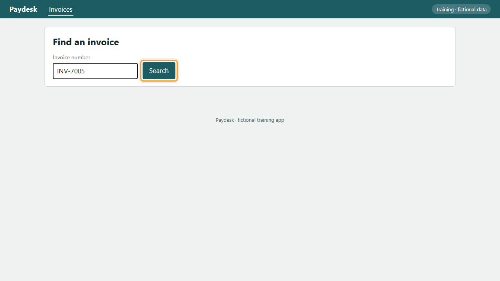

<!-- Generated by tooling/procedure_render.py from procedures/procure-to-pay/P2P-03-P01/procedure.yaml. Do not edit; change the procedure and re-run. -->

# P2P-03-P01: Abrir una factura / Open an invoice

=== "Español"

    ## Abrir una factura

    Busque una factura por su número y ábrala para revisarla, añadir notas o aprobarla.

    !!! info ""
        Grabado en Paydesk, una aplicación de formación ficticia que hace las veces del sistema real.

    !!! success ""
        Verificado el 2026-11-11 en Paydesk 1.0.0. Pasos correctos: 4. Comprobaciones de datos correctas: 1.

    | Rol | Sistema | Proceso | Responsable | Versión |
    |---|---|---|---|---|
    | AP Clerk | demo-app | [P2P-03](../../processes/procure-to-pay/P2P-03.md) | Example process owner | 1.0.0 (Borrador) |

    Fuente: Example procedure for the P2P-03 invoice approval board

    ### Vídeo

    <video controls preload="metadata" width="100%" src="../media/P2P-03-P01-es.mp4"><track kind="subtitles" srclang="es" label="Español" src="../media/P2P-03-P01-es.vtt" default>Su navegador no puede reproducir este vídeo.</video>

    ### Pasos

    1. Abra Paydesk en la pantalla de facturas.

        *Resultado esperado:* Se abre «Buscar una factura».

        

    2. Escriba el número de la factura.

        *Resultado esperado:* El campo «Nº de factura» muestra «nº de factura».

        

    3. Pulse Buscar. La factura aparece en la lista.

        *Resultado esperado:* Se ve «nº de factura».

        

    4. Pulse el número de la factura para abrirla.

        *Resultado esperado:* Se abre «Detalle de la factura».

        

=== "English"

    ## Open an invoice

    Find an invoice by its number and open it to review it, add notes or approve it.

    !!! info ""
        Recorded in Paydesk, a fictional training app that stands in for the real system.

    !!! success ""
        Verified on 2026-11-11 in Paydesk 1.0.0. Steps passed: 4. Data checks passed: 1.

    | Role | System | Process | Owner | Version |
    |---|---|---|---|---|
    | AP Clerk | demo-app | [P2P-03](../../processes/procure-to-pay/P2P-03.md) | Example process owner | 1.0.0 (Draft) |

    Source: Example procedure for the P2P-03 invoice approval board

    ### Video

    <video controls preload="metadata" width="100%" src="../media/P2P-03-P01-en.mp4"><track kind="subtitles" srclang="en" label="English" src="../media/P2P-03-P01-en.vtt" default>Your browser can't play this video.</video>

    ### Steps

    1. Open Paydesk on the invoices screen.

        *Expected result:* «Find an invoice» opens.

        

    2. Type the invoice number.

        *Expected result:* The «Invoice number» field shows «invoice number».

        

    3. Select Search. The invoice appears in the list.

        *Expected result:* «invoice number» is shown.

        

    4. Select the invoice number to open it.

        *Expected result:* «Invoice details» opens.

        
