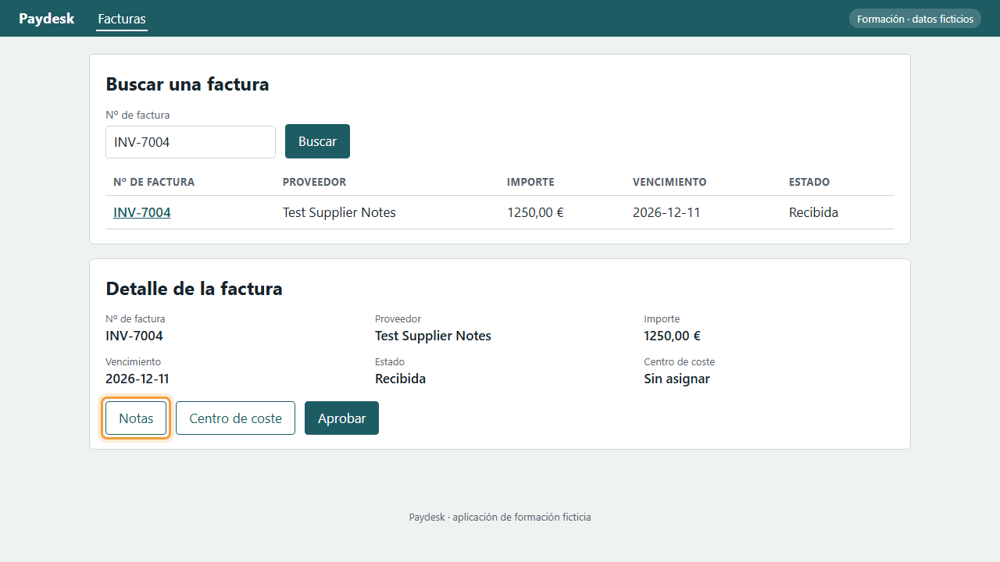
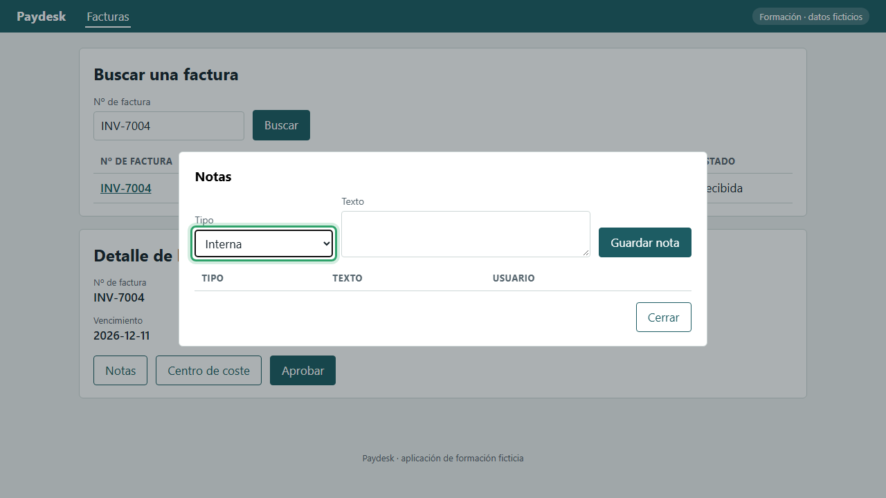
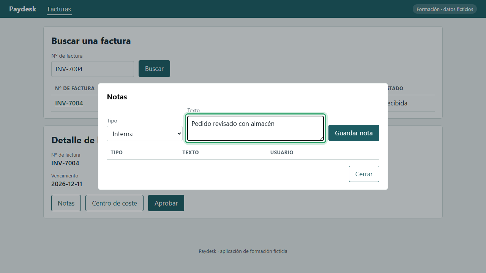
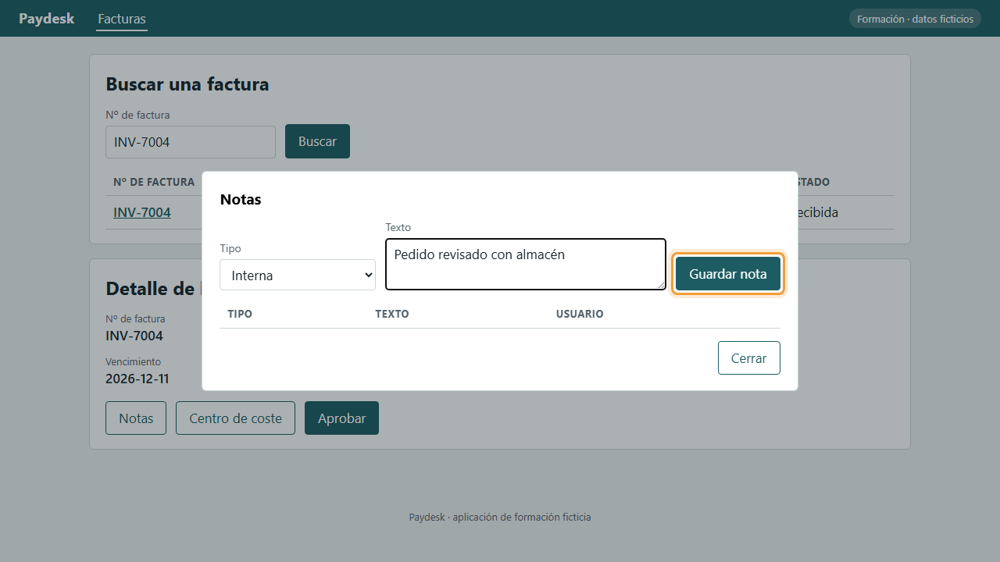
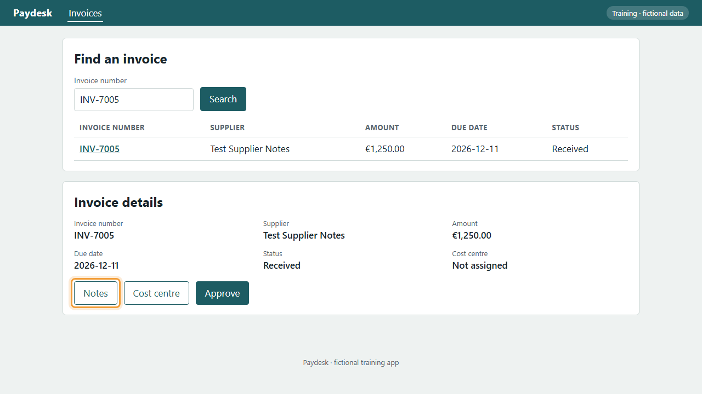
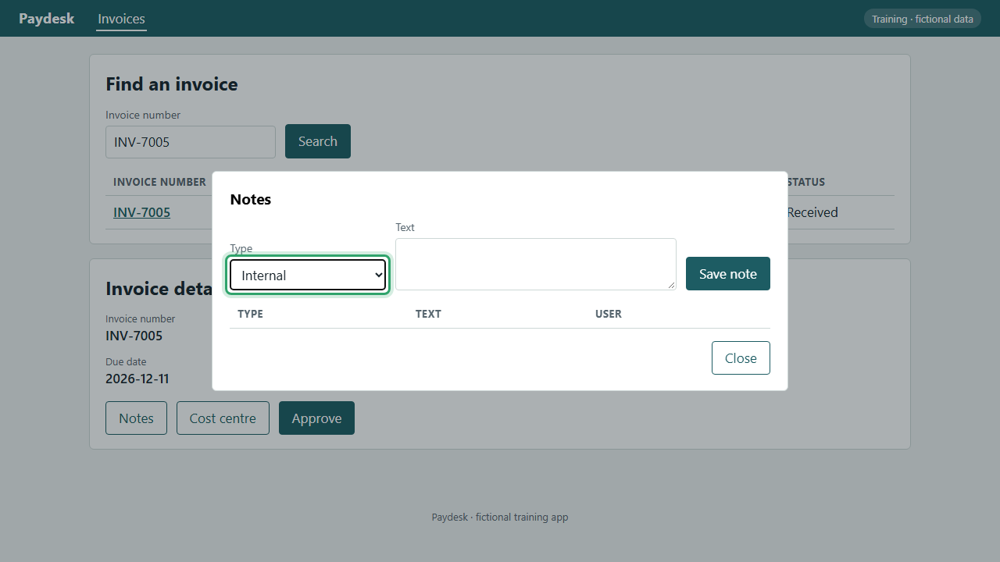
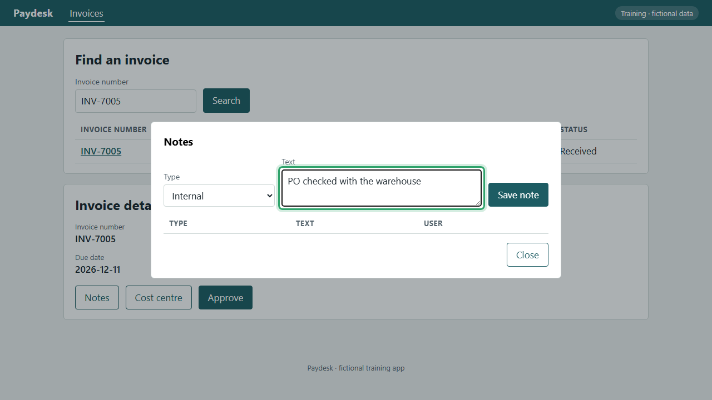
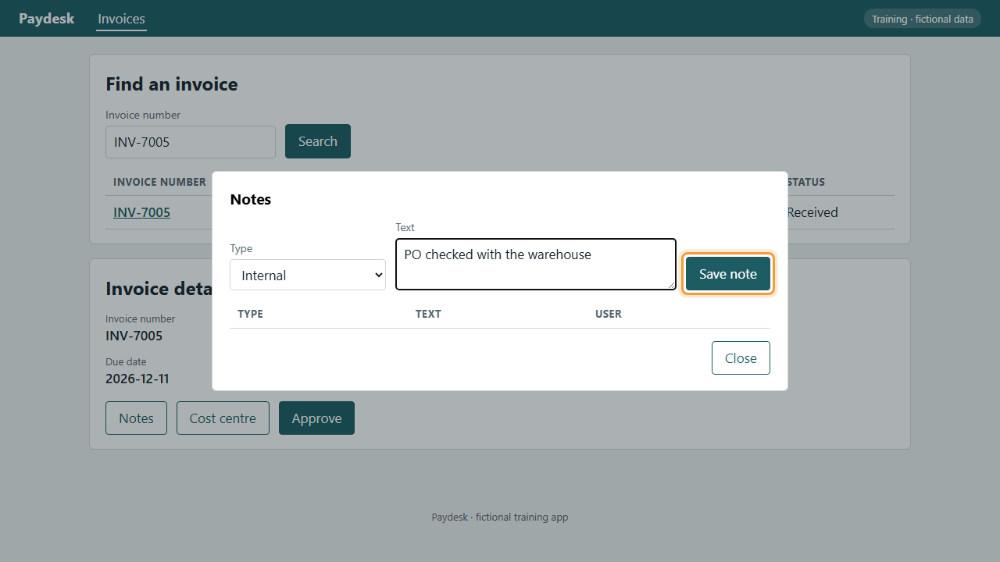

<!-- Generated by tooling/procedure_render.py from procedures/procure-to-pay/P2P-03-P02/procedure.yaml. Do not edit; change the procedure and re-run. -->

# P2P-03-P02: Añadir una nota interna a una factura / Add an internal note to an invoice

=== "Español"

    ## Añadir una nota interna a una factura

    Deje una nota que solo verá el equipo de cuentas a pagar, por ejemplo qué se ha comprobado del pedido.

    !!! tip ""
        Antes de empezar: [P2P-03-P01: Abrir una factura](../procure-to-pay/P2P-03-P01.md). Este procedimiento empieza donde termina ese.

    !!! info ""
        Grabado en Paydesk, una aplicación de formación ficticia que hace las veces del sistema real.

    !!! success ""
        Verificado el 2026-11-11 en Paydesk 1.0.0. Pasos correctos: 4. Comprobaciones de datos correctas: 3.

    | Rol | Sistema | Proceso | Responsable | Versión |
    |---|---|---|---|---|
    | AP Clerk | demo-app | [P2P-03](../../processes/procure-to-pay/P2P-03.md) | Example process owner | 1.0.0 (Borrador) |

    Fuente: Example procedure for the P2P-03 invoice approval board

    ### Vídeo

    <video controls preload="metadata" width="100%" src="../media/P2P-03-P02-es.mp4"><track kind="subtitles" srclang="es" label="Español" src="../media/P2P-03-P02-es.vtt" default>Su navegador no puede reproducir este vídeo.</video>

    ### Pasos

    1. Con la factura abierta, pulse Notas.

        *Resultado esperado:* Se abre la ventana «Notas».

        

    2. En Tipo, elija Interna. Solo la verá el equipo.

        *Resultado esperado:* El campo «Tipo» muestra «internal».

        

    3. Escriba la nota en Texto.

        *Resultado esperado:* El campo «Texto» muestra «Pedido revisado con almacén».

        

    4. Pulse Guardar nota. La nota queda en la lista con su usuario.

        *Resultado esperado:* La lista muestra «Pedido revisado con almacén» con «demo.clerk».

        

=== "English"

    ## Add an internal note to an invoice

    Leave a note only the accounts payable team will see, for example what was checked against the purchase order.

    !!! tip ""
        Before you start: [P2P-03-P01: Open an invoice](../procure-to-pay/P2P-03-P01.md). This procedure starts where that one ends.

    !!! info ""
        Recorded in Paydesk, a fictional training app that stands in for the real system.

    !!! success ""
        Verified on 2026-11-11 in Paydesk 1.0.0. Steps passed: 4. Data checks passed: 3.

    | Role | System | Process | Owner | Version |
    |---|---|---|---|---|
    | AP Clerk | demo-app | [P2P-03](../../processes/procure-to-pay/P2P-03.md) | Example process owner | 1.0.0 (Draft) |

    Source: Example procedure for the P2P-03 invoice approval board

    ### Video

    <video controls preload="metadata" width="100%" src="../media/P2P-03-P02-en.mp4"><track kind="subtitles" srclang="en" label="English" src="../media/P2P-03-P02-en.vtt" default>Your browser can't play this video.</video>

    ### Steps

    1. With the invoice open, select Notes.

        *Expected result:* The «Notes» window opens.

        

    2. Under Type, choose Internal. Only the team will see it.

        *Expected result:* The «Type» field shows «internal».

        

    3. Write the note under Text.

        *Expected result:* The «Text» field shows «PO checked with the warehouse».

        

    4. Select Save note. The note is listed with your user.

        *Expected result:* The list shows «PO checked with the warehouse» with «demo.clerk».

        
