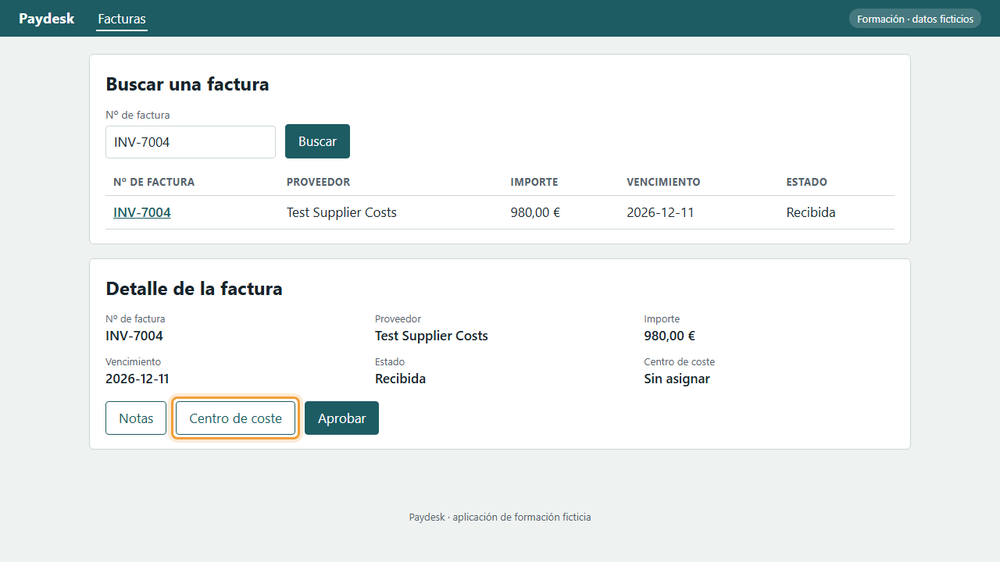
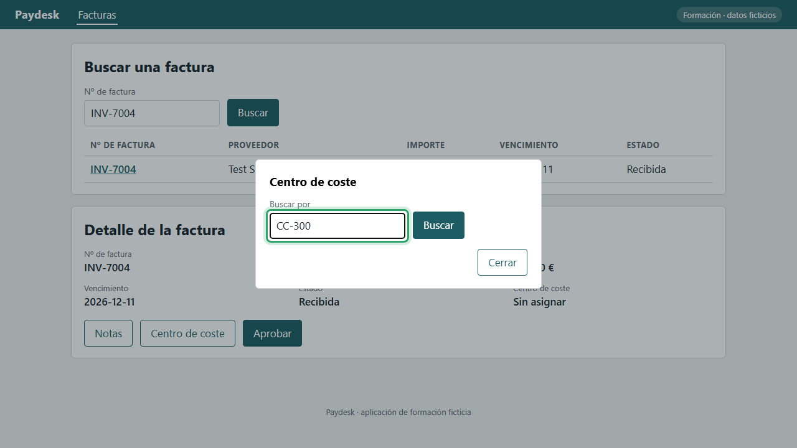
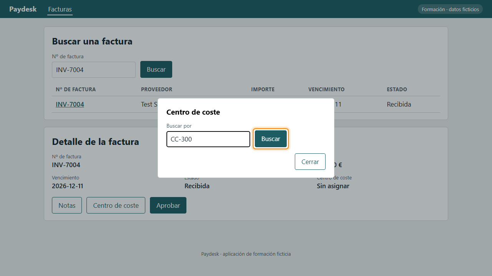
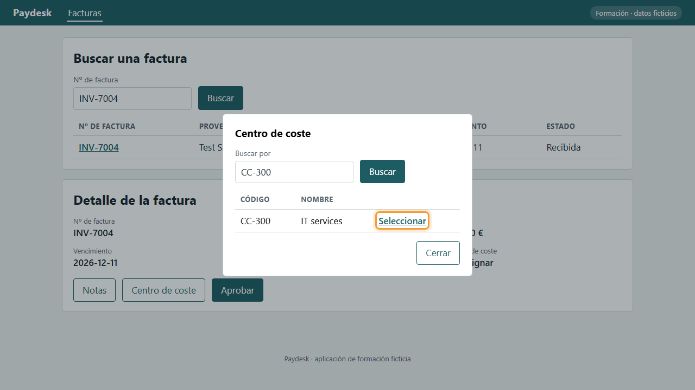
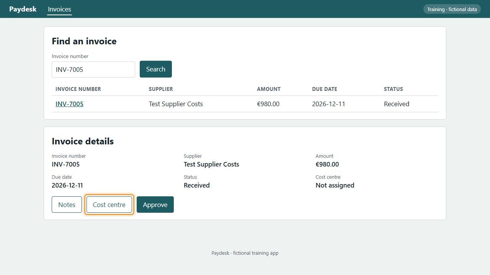
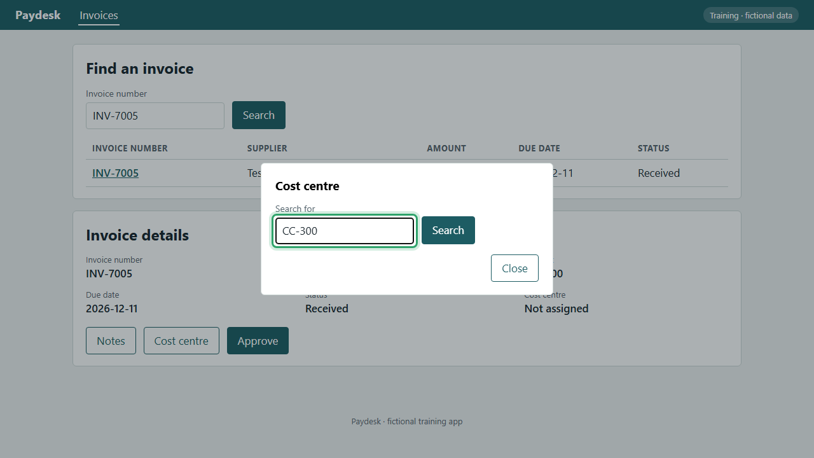
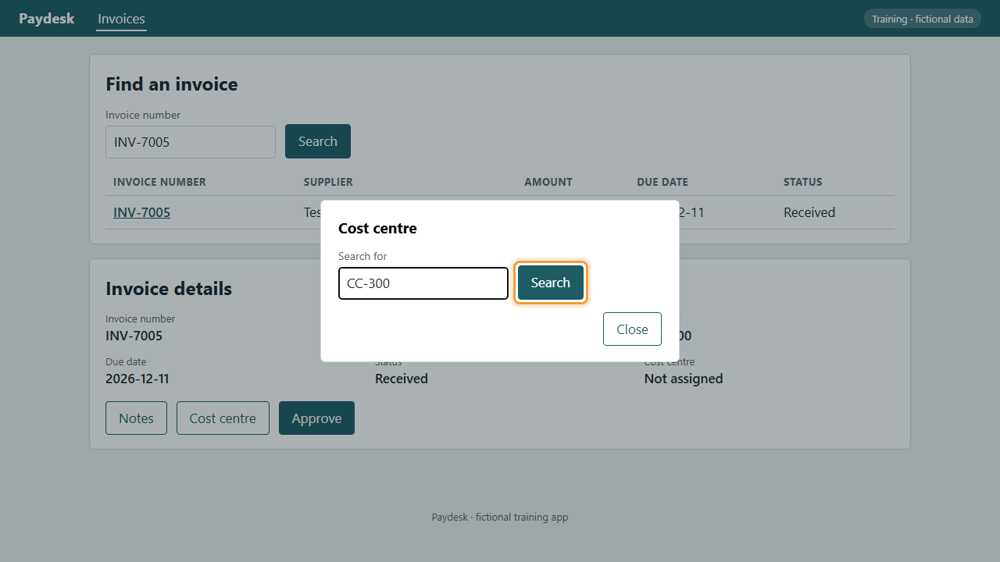
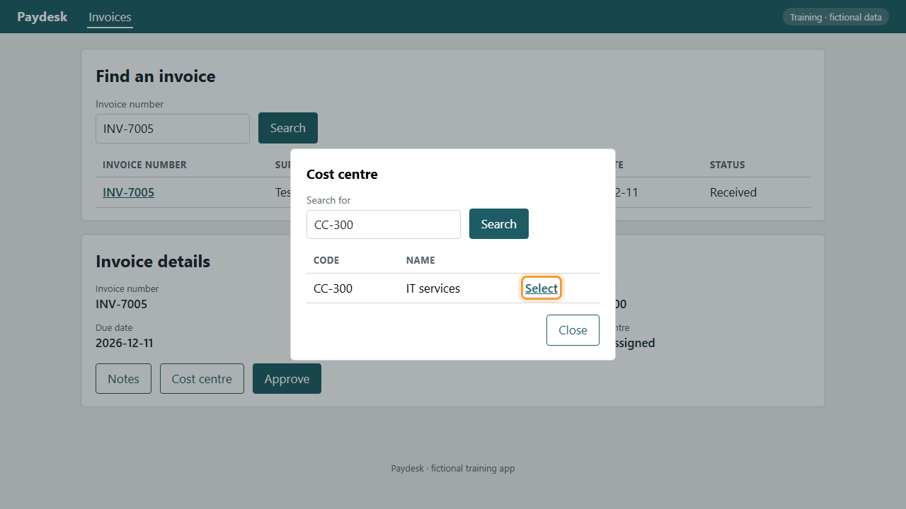

<!-- Generated by tooling/procedure_render.py from procedures/procure-to-pay/P2P-03-P03/procedure.yaml. Do not edit; change the procedure and re-run. -->

# P2P-03-P03: Asignar el centro de coste / Assign the cost centre

=== "Español"

    ## Asignar el centro de coste

    Busque el centro de coste y asígnelo a la factura, para que el gasto se cargue al departamento correcto.

    !!! tip ""
        Antes de empezar: [P2P-03-P01: Abrir una factura](../procure-to-pay/P2P-03-P01.md). Este procedimiento empieza donde termina ese.

    !!! info ""
        Grabado en Paydesk, una aplicación de formación ficticia que hace las veces del sistema real.

    !!! success ""
        Verificado el 2026-11-11 en Paydesk 1.0.0. Pasos correctos: 4. Comprobaciones de datos correctas: 1.

    | Rol | Sistema | Proceso | Responsable | Versión |
    |---|---|---|---|---|
    | AP Clerk | demo-app | [P2P-03](../../processes/procure-to-pay/P2P-03.md) | Example process owner | 1.0.0 (Borrador) |

    Fuente: Example procedure for the P2P-03 invoice approval board

    ### Vídeo

    <video controls preload="metadata" width="100%" src="../media/P2P-03-P03-es.mp4"><track kind="subtitles" srclang="es" label="Español" src="../media/P2P-03-P03-es.vtt" default>Su navegador no puede reproducir este vídeo.</video>

    ### Pasos

    1. Con la factura abierta, pulse Centro de coste.

        *Resultado esperado:* Se abre la ventana «Centro de coste».

        

    2. En Buscar por, escriba el código: CC-300.

        *Resultado esperado:* El campo «Buscar por» muestra «CC-300».

        

    3. Pulse Buscar en la ventana. Aparece el centro de coste.

        *Resultado esperado:* La lista muestra «CC-300».

        

    4. Pulse Seleccionar. La ventana se cierra y la factura muestra el centro de coste.

        *Resultado esperado:* Se abre la ventana «Centro de coste».

        

=== "English"

    ## Assign the cost centre

    Search for the cost centre and assign it to the invoice, so the spend is charged to the right department.

    !!! tip ""
        Before you start: [P2P-03-P01: Open an invoice](../procure-to-pay/P2P-03-P01.md). This procedure starts where that one ends.

    !!! info ""
        Recorded in Paydesk, a fictional training app that stands in for the real system.

    !!! success ""
        Verified on 2026-11-11 in Paydesk 1.0.0. Steps passed: 4. Data checks passed: 1.

    | Role | System | Process | Owner | Version |
    |---|---|---|---|---|
    | AP Clerk | demo-app | [P2P-03](../../processes/procure-to-pay/P2P-03.md) | Example process owner | 1.0.0 (Draft) |

    Source: Example procedure for the P2P-03 invoice approval board

    ### Video

    <video controls preload="metadata" width="100%" src="../media/P2P-03-P03-en.mp4"><track kind="subtitles" srclang="en" label="English" src="../media/P2P-03-P03-en.vtt" default>Your browser can't play this video.</video>

    ### Steps

    1. With the invoice open, select Cost centre.

        *Expected result:* The «Cost centre» window opens.

        

    2. In Search for, type the code: CC-300.

        *Expected result:* The «Search for» field shows «CC-300».

        

    3. Select Search in the window. The cost centre appears.

        *Expected result:* The list shows «CC-300».

        

    4. Select Select. The window closes and the invoice shows the cost centre.

        *Expected result:* The «Cost centre» window opens.

        
