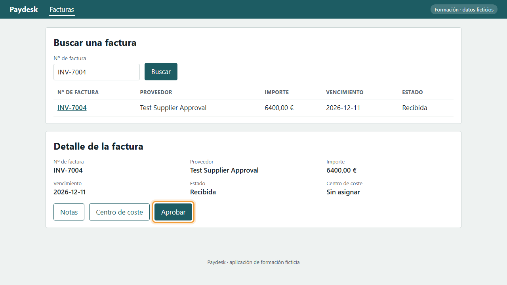
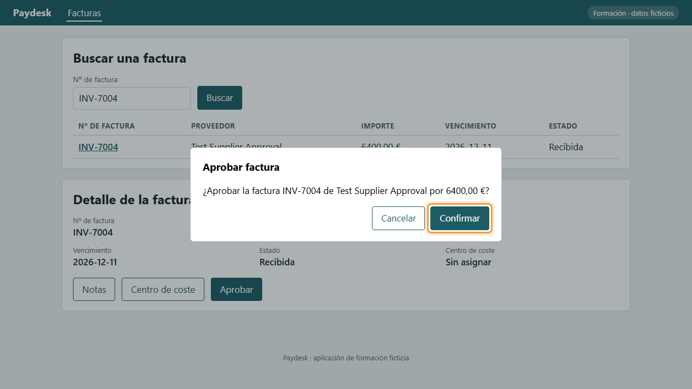
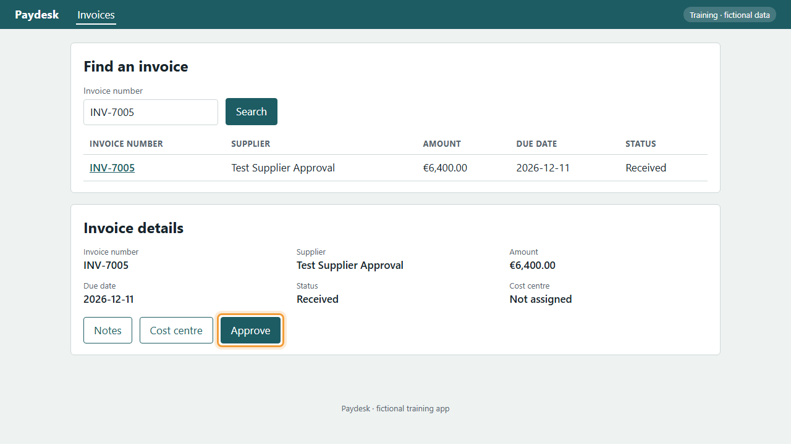
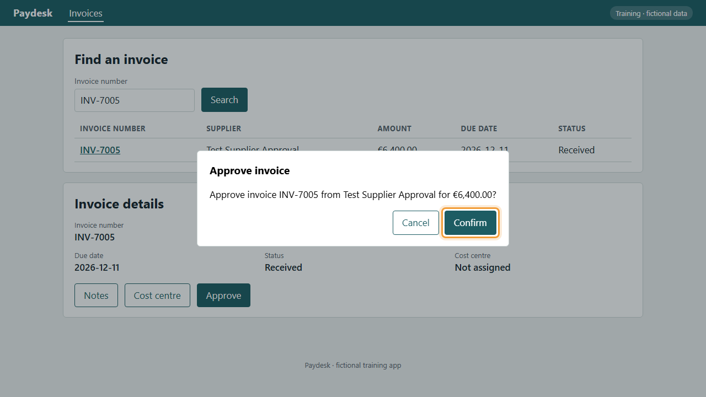

<!-- Generated by tooling/procedure_render.py from procedures/procure-to-pay/P2P-03-P04/procedure.yaml. Do not edit; change the procedure and re-run. -->

# P2P-03-P04: Aprobar una factura / Approve an invoice

=== "Español"

    ## Aprobar una factura

    Apruebe una factura revisada para que se pueda programar el pago.

    !!! tip ""
        Antes de empezar: [P2P-03-P01: Abrir una factura](../procure-to-pay/P2P-03-P01.md). Este procedimiento empieza donde termina ese.

    !!! info ""
        Grabado en Paydesk, una aplicación de formación ficticia que hace las veces del sistema real.

    !!! success ""
        Verificado el 2026-11-11 en Paydesk 1.0.0. Pasos correctos: 2. Comprobaciones de datos correctas: 2.

    | Rol | Sistema | Proceso | Responsable | Versión |
    |---|---|---|---|---|
    | Finance Manager | demo-app | [P2P-03](../../processes/procure-to-pay/P2P-03.md) | Example process owner | 1.0.0 (Borrador) |

    Fuente: Example procedure for the P2P-03 invoice approval board

    ### Vídeo

    <video controls preload="metadata" width="100%" src="../media/P2P-03-P04-es.mp4"><track kind="subtitles" srclang="es" label="Español" src="../media/P2P-03-P04-es.vtt" default>Su navegador no puede reproducir este vídeo.</video>

    ### Pasos

    1. Con la factura abierta, pulse Aprobar.

        *Resultado esperado:* Se abre la ventana «Aprobar factura».

        

    2. Compruebe el proveedor y el importe y pulse Confirmar.

        *Resultado esperado:* Aparece el mensaje «Factura nº de factura aprobada.».

        

=== "English"

    ## Approve an invoice

    Approve a checked invoice so its payment can be scheduled.

    !!! tip ""
        Before you start: [P2P-03-P01: Open an invoice](../procure-to-pay/P2P-03-P01.md). This procedure starts where that one ends.

    !!! info ""
        Recorded in Paydesk, a fictional training app that stands in for the real system.

    !!! success ""
        Verified on 2026-11-11 in Paydesk 1.0.0. Steps passed: 2. Data checks passed: 2.

    | Role | System | Process | Owner | Version |
    |---|---|---|---|---|
    | Finance Manager | demo-app | [P2P-03](../../processes/procure-to-pay/P2P-03.md) | Example process owner | 1.0.0 (Draft) |

    Source: Example procedure for the P2P-03 invoice approval board

    ### Video

    <video controls preload="metadata" width="100%" src="../media/P2P-03-P04-en.mp4"><track kind="subtitles" srclang="en" label="English" src="../media/P2P-03-P04-en.vtt" default>Your browser can't play this video.</video>

    ### Steps

    1. With the invoice open, select Approve.

        *Expected result:* The «Approve invoice» window opens.

        

    2. Check the supplier and the amount and select Confirm.

        *Expected result:* The message «Invoice invoice number approved.» appears.

        
