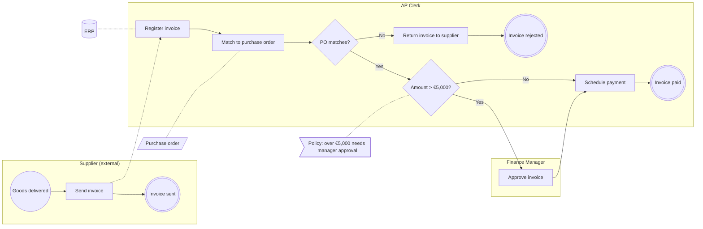

# P2P-03: Invoice approval

!!! warning "DRAFT"
    Status `in-review`. This process has not been validated by a business SME. Do not build against it.

<!-- generated:start (tooling/workflow_render.py; edit the FigJam board, not this block) -->

| | |
|---|---|
| Process ID | `P2P-03` |
| Version | `1.0.0` |
| Status | in-review |
| Owner | AP Lead |
| State | as-is |
| Last updated | 2026-10-06 |
| Source | [FigJam section](https://www.figma.com/board/EXAMPLEFILEKEY0000000000/?node-id=2-131) |
| Machine-readable | [`workflow.yaml`](https://github.com/shawndale-glitch/figjam-process-pipeline/blob/main/workflows/procure-to-pay/P2P-03/workflow.yaml) · [changelog](https://github.com/shawndale-glitch/figjam-process-pipeline/blob/main/workflows/procure-to-pay/P2P-03/CHANGELOG.md) · [scenarios](https://github.com/shawndale-glitch/figjam-process-pipeline/blob/main/conformance/P2P-03/scenarios.feature) |

## Flow

## Steps

| Step | Lane | Type | Label | Next |
|---|---|---|---|---|
| [`11:241`](https://www.figma.com/board/EXAMPLEFILEKEY0000000000/?node-id=11-241) | Supplier (external) | event.start | Goods delivered | Send invoice |
| [`11:244`](https://www.figma.com/board/EXAMPLEFILEKEY0000000000/?node-id=11-244) | Supplier (external) | task | Send invoice | Invoice sent; Register invoice |
| [`11:246`](https://www.figma.com/board/EXAMPLEFILEKEY0000000000/?node-id=11-246) | Supplier (external) | event.end | Invoice sent | — |
| [`11:249`](https://www.figma.com/board/EXAMPLEFILEKEY0000000000/?node-id=11-249) | AP Clerk | task | Register invoice | Match to purchase order |
| [`11:251`](https://www.figma.com/board/EXAMPLEFILEKEY0000000000/?node-id=11-251) | AP Clerk | task | Match to purchase order | PO matches? |
| [`11:256`](https://www.figma.com/board/EXAMPLEFILEKEY0000000000/?node-id=11-256) | AP Clerk | gateway.xor | PO matches? | **Yes** → Amount > €5,000?; **No** → Return invoice to supplier |
| [`11:259`](https://www.figma.com/board/EXAMPLEFILEKEY0000000000/?node-id=11-259) | AP Clerk | gateway.xor | Amount > €5,000? | **No** → Schedule payment; **Yes** → Approve invoice |
| [`11:262`](https://www.figma.com/board/EXAMPLEFILEKEY0000000000/?node-id=11-262) | AP Clerk | task | Schedule payment | Invoice paid |
| [`11:264`](https://www.figma.com/board/EXAMPLEFILEKEY0000000000/?node-id=11-264) | AP Clerk | event.end | Invoice paid | — |
| [`11:267`](https://www.figma.com/board/EXAMPLEFILEKEY0000000000/?node-id=11-267) | AP Clerk | task | Return invoice to supplier | Invoice rejected |
| [`11:269`](https://www.figma.com/board/EXAMPLEFILEKEY0000000000/?node-id=11-269) | AP Clerk | event.end | Invoice rejected | — |
| [`11:280`](https://www.figma.com/board/EXAMPLEFILEKEY0000000000/?node-id=11-280) | Finance Manager | task | Approve invoice | Schedule payment |

## Business rules

| Rule | Applies to |
|---|---|
| Policy: over €5,000 needs manager approval | Amount > €5,000? |

## Systems and data

- ERP (system)
- Purchase order (document)

## Conformance

| Consumer | Version | C1 | C2 | C3 | C4 |
|---|---|---|---|---|---|
| — | — | not verified | not verified | not verified | not verified |

<!-- generated:end -->
